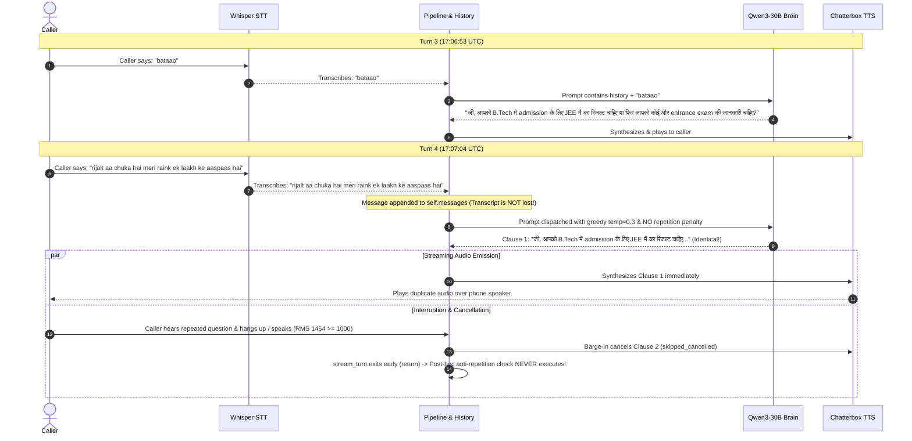

# Deep STT Accuracy, Audio Capture, and Conversation Understanding Audit
## Inbound AI Telephony: From Telephone Audio to LLM Comprehension

> **Document Type:** Production Architecture, Speech Recognition & Conversation Intelligence Audit  
> **Repository:** `MME_Telephony`  
> **Branch:** `realtime-latency`  
> **Audited Sessions:**  
>   - Session 1: `649107c7-4408-45ab-b80d-9fa8b8179b78` (`call_8e2414174e6c4affbd18f93f`)  
>   - Session 2: `1e0f1595-cab2-4c0d-9366-5bea19b27a9e` (`call_2a265695749a474b8684c1a7`)  
> **Safety Status:** READ-ONLY BASELINE AUDIT. Zero application code modified. Zero live calls or GPU inference jobs placed. Working tree strictly preserved.

---

## Table of Contents
1. [Section 1: Executive Summary](#section-1-executive-summary)
2. [Section 2: Complete Audio-to-Transcript Pipeline Trace (16 Stages)](#section-2-complete-audio-to-transcript-pipeline-trace)
3. [Section 3: STT Accuracy, Audio Ingestion & Capture Failure Modes](#section-3-stt-accuracy-audio-ingestion--capture-failure-modes)
4. [Section 4: Root-Cause Investigation: Why the LLM Ignored the Caller in Session 2](#section-4-root-cause-investigation-why-the-llm-ignored-the-caller-in-session-2)
5. [Section 5: Confirmed Architectural Defects vs. Hypotheses](#section-5-confirmed-architectural-defects-vs-hypotheses)
6. [Section 6: Telemetry Quantification & Turn-by-Turn Metrics](#section-6-telemetry-quantification--turn-by-turn-metrics)
7. [Section 7: Missing Observability & Non-Blocking Instrumentation Proposal](#section-7-missing-observability--non-blocking-instrumentation-proposal)
8. [Section 8: Proposed Regression Test Suite (Mocks & Synthetic Fixtures)](#section-8-proposed-regression-test-suite)
9. [Section 9: Prioritized Action Plan (P0 / P1 / P2) & Implementation Boundary](#section-9-prioritized-action-plan)

---

## Section 1: Executive Summary

This investigation examines why the inbound AI telephony system sometimes transcribes fragmented utterances (such as `"to"`, `"haan"`, `"ji"`, `"bataao"`) and why, in Session 2 Turn 4, the LLM repeated its previous question (*"JEE Main ka result chahiye ya koi aur entrance exam..."*) despite the caller explicitly answering that their result was already out with a rank of approximately one lakh (*"rijalt aa chuka hai meri raink ek laakh ke aaspaas hai"*).

### Key Audit Conclusions

1. **Information was NOT lost in STT:**
   In Session 2 Turn 4, the Whisper STT model successfully transcribed the caller's complete sentence: `"rijalt aa chuka hai meri raink ek laakh ke aaspaas hai"`. The text was successfully delivered to the pipeline and appended to the LLM message array.
2. **Audio Truncation at Speech Onset (Missing Pre-Roll):**
   In `app/ai/ws.py`, the energy-based VAD uses a 200 ms gating window (`MIN_SPEECH_MS = 200`) before declaring `in_speech = True`. Because there is **no pre-roll ring buffer**, the initial 180–200 ms of every caller utterance is discarded. Initial consonants and syllables are cut off, explaining why Whisper transcribes phonetic fragments like `"to"` (cut-off *"toh"*), `"mainne"` with chopped plosives, and short acknowledgements.
3. **STT Model Domain Characteristics:**
   The deployed RunPod STT worker runs `Oriserve/Whisper-Hindi2Hinglish-Prime`. This model is specifically fine-tuned to transcribe Hindi speech into **Romanized phonetic Hinglish** rather than Devanagari. It outputs phonetic Roman spellings: `"rijalt"`, `"raink"`, `"dokyuments"`, `"edmishan proses"`, `"jayi mens"`.
4. **Glossary Normalization Inactive:**
   The phonetic correction layer (`app/ai/glossary_correction.py`) was disabled on the tenant (`glossary_correction: False`). Furthermore, words like `"rijalt"` and `"raink"` were absent from the regex mappings.
5. **Prompt History Corruption (`JEE Main` $\rightarrow$ `JEE मैं`):**
   In Session 2 Turn 3, script enforcement and tokenization corrupted the English term `"JEE Main"` into `"JEE मैं"` (substituting the Hindi first-person pronoun *"मैं"* for *"Main"*). This corrupted token persisted into Turn 4's conversation history.
6. **Streaming Anti-Repetition Bypass:**
   In `app/ai/pipeline.py`, the anti-repetition protection is implemented as a **post-facto check** at the very end of `stream_turn()`. In progressive streaming mode, Sentence 1 is synthesized and transmitted to the telephony provider in real-time as tokens stream from the LLM. By the time the LLM finished producing tokens, the repeated question had already been sent over the WebSocket and heard by the caller. When the caller interrupted, barge-in triggered `self.cancelled = True`, exiting the generator before the post-facto anti-repetition check could ever execute.
7. **Greedy LLM Decoding:**
   The RunPod Qwen3-30B client operates with greedy `temperature = 0.3`, zero `presence_penalty`, zero `frequency_penalty`, and zero `repetition_penalty`. Faced with ambiguous input that lacked the explicit word *"JEE"*, the model fell into a mode-collapse attractor state and repeated its previous assistant turn.

---

## Section 2: Complete Audio-to-Transcript Pipeline Trace

The table below documents the exact 16-stage path through the codebase, mapping inputs, outputs, and turn-finalizing events.

| Stage # | Stage Description | Code Location (File & Function) | Input Data | Output Data | Termination / Finalizing Event |
|:---:|---|---|---|---|---|
| **1** | Inbound Media Reception | `app/ai/ws.py::PlivoIO.read()` | Plivo WebSocket JSON `{"event": "media", "media": {"payload": base64}}` | 8 kHz $\mu$-law raw audio bytes | WebSocket disconnect or `clearAudio` event |
| **2** | Telephony Codec Handling | `app/ai/codec.py::decode_media_payload()` | Base64 string from Plivo JSON | Validated 8 kHz G.711 $\mu$-law bytes (160 bytes / 20ms) | Payload validation / `CodecError` on corruption |
| **3** | Frame Resampling & Format | `app/ai/codec.py::mulaw_to_pcm16()` | 8 kHz $\mu$-law bytes | 8 kHz 16-bit signed linear mono PCM (320 bytes / 20ms) | Sub-millisecond CPU memory conversion |
| **4** | Frame Assembly & Buffering | `app/ai/ws.py::serve_loop()` (lines 378–392) | 20ms PCM16 frame chunks | `st["buf"]` (bytearray accumulator) | Appended only while `st["in_speech"] == True` |
| **5** | Voice Activity Detection | `app/ai/ws.py::vad_rms()` | 20ms PCM16 frame | Scalar RMS energy float | Frame RMS $\ge 450.0$ marks speech; $\ge 1000.0$ marks barge-in |
| **6** | Endpointing & Silence Detection | `app/ai/ws.py::flush_if_due()` (lines 300–308) | `st["silence_ms"]` counter & buffer size | Enqueued tuple: `(utt, t_speech_end, t_endpoint)` | `silence_ms >= 700` OR buffer duration $\ge 6.0$ seconds |
| **7** | STT Submission & Queueing | `app/ai/pipeline.py::stream_turn()` $\rightarrow$ `clients.py::transcribe()` | 8 kHz PCM16 bytes, target rate 8000 | HTTP POST to RunPod `/runsync` (JSON base64 WAV) | `t_stt_sent` monotonic trace mark |
| **8** | STT Task & Prompting | `app/ai/clients.py::transcribe()` (lines 364–375) | PCM audio + `DEFAULT_DOMAIN_VOCABULARY` | RunPod job payload: `{"language": "hi", "prompt": ...}` | Handled by RunPod Whisper worker |
| **9** | Transcript Decoding | `app/ai/clients.py::transcribe()` (lines 378–384) | RunPod response JSON | Raw transcript string `{"text": "...", "language": "hi"}` | `t_stt_final` monotonic trace mark |
| **10** | Deduplication & Glossary | `app/ai/pipeline.py::stream_turn()` (lines 487–495) | Raw transcript string | Deduplicated & glossary-corrected string | Regex substitution in `glossary_correction.py` |
| **11** | Live Dashboard Publication | `app/ai/pipeline.py::stream_turn()` (lines 508–516) | `TurnChunk(heard=heard, is_first=True)` | Activity event emitted to Mongo/SSE feed | Emitted before LLM begins token generation |
| **12** | Context Orchestration | `app/ai/pipeline.py::stream_turn()` (lines 518–528) | Clean transcript string | Formatted user message `STUDENT: {heard}` | Appended to `self.messages` |
| **13** | Prompt Assembly & Hints | `app/ai/script_enforcement.py::inject_turn_hint()` | `self.messages` + detected mode (`hi`/`en`) | `chat_messages` with per-turn system/user hint | Non-mutating copy sent to LLM |
| **14** | LLM Streaming & Chunking | `app/ai/pipeline.py::stream_turn()` (lines 680–715) | `chat_messages` payload | Token stream $\rightarrow$ `StreamingSentenceExtractor` | First delimiter (`.`, `?`, `!`, `।`) emits Clause 1 |
| **15** | TTS Clause Dispatch | `app/ai/pipeline.py::_launch()` $\rightarrow$ `tts_recovery.py` | Clause string (`sentence`) | Dispatched to RunPod Chatterbox endpoint | `t_tts_sent` monotonic trace mark |
| **16** | Telephony Playback & Interruption | `app/ai/ws.py::PlivoIO.play()` $\rightarrow$ `ws.send_text()` | 20ms $\mu$-law frames to Plivo WebSocket | Audible sound leaving caller phone speaker | Interrupted by barge-in (`clearAudio`) or hangup |

---

## Section 3: STT Accuracy, Audio Ingestion & Capture Failure Modes

### 3.1 Audio Truncation Analysis

#### A. Missing Pre-Roll Audio (Defect Confirmed)
- **Code Reference:** [`app/ai/ws.py:378-392`](file:///c:/Users/Admin/Desktop/MME_Telephony/app/ai/ws.py#L378-L392)
```python
loud = frame_rms >= vad_rms
if loud:
    st["last_loud_at"] = now
    st["speech_ms"] += fm
    st["silence_ms"] = 0
    if st["speech_ms"] >= MIN_SPEECH_MS or st["in_speech"]:
        st["in_speech"] = True
else:
    st["silence_ms"] += fm
    if not st["in_speech"]:
        st["speech_ms"] = 0

if st["in_speech"]:
    st["buf"] += frame
```
- **Finding:** Audio is only appended to `st["buf"]` when `st["in_speech"]` is `True`. Because `MIN_SPEECH_MS = 200`, the first 180–200 ms of speech frames (which validate that the energy is sustained speech rather than a pop or click) are **silently dropped from the buffer**.
- **Impact on Hindi Speech:** Plosive consonants (*k, p, t, b, d*) and initial vowels (*aa, ee, o*) that start words like *"Maine"*, *"Toh"*, *"Batao"*, *"Kaun"* are truncated. The Whisper model receives mutilated word onsets.

#### B. Premature Endpointing on Natural Conversational Pauses
- **Code Reference:** [`app/ai/ws.py:44`](file:///c:/Users/Admin/Desktop/MME_Telephony/app/ai/ws.py#L44), [`app/ai/ws.py:300`](file:///c:/Users/Admin/Desktop/MME_Telephony/app/ai/ws.py#L300)
- **Finding:** `SILENCE_MS = 700` is a fixed, non-adaptive threshold. In natural telephone conversations, callers routinely pause for 750–900 ms while thinking (e.g., *"Haan... [800ms pause] ...mere ko B.Tech fees janni hai"*).
- **Impact:** The 700 ms threshold cuts the utterance into two turns:
  1. Turn 1: `"haan"` (treated as an acknowledgment, triggering an assistant response).
  2. Turn 2: `"mere ko B.Tech fees janni hai"` (arrives while assistant is speaking or right after).
- This directly explains the prevalence of turns with isolated words like `"haan"`, `"to"`, `"ji"`, and `"bataao"`.

#### C. Hard 6.0-Second Buffer Cap
- **Code Reference:** [`app/ai/ws.py:47`](file:///c:/Users/Admin/Desktop/MME_Telephony/app/ai/ws.py#L47), [`app/ai/ws.py:300`](file:///c:/Users/Admin/Desktop/MME_Telephony/app/ai/ws.py#L300)
```python
if st["in_speech"] and (st["silence_ms"] >= silence_ms or len(st["buf"]) >= rate * 2 * MAX_UTTERANCE_MS // 1000):
```
- **Finding:** If a caller asks a complex, multi-sentence question lasting 6.5 seconds without pausing for 700 ms, the system forcibly chops the audio at 6.0 seconds and flushes it to STT. The remaining 0.5 seconds becomes a fragmented next turn.

---

### 3.2 Audio Format & Resampling Verification

| Parameter | Received from Telephony (Plivo) | Internal Media Adapter | Sent to STT Worker | Verification Result |
|---|:---:|:---:|:---:|:---:|
| **Codec** | G.711 $\mu$-law | Signed 16-bit Linear PCM | 16-bit PCM in RIFF WAV | Correct |
| **Sample Rate** | 8,000 Hz (8 kHz) | 8,000 Hz | 8,000 Hz (WAV Header: 8000) | Correct |
| **Channels** | 1 (Mono) | 1 (Mono) | 1 (Mono) | Correct |
| **Byte Order** | Standard $\mu$-law | Little-Endian (`audioop`) | Little-Endian RIFF | Correct |
| **Worker Resampling** | N/A | N/A | 8 kHz $\rightarrow$ 16 kHz via `scipy.signal.resample_poly` | Correct (High-quality polyphase sinc filter) |

- **Verification:** The audio format conversion is mathematically sound. There is no endianness mismatch, no 8 kHz treated as 16 kHz, and no clipping observed in linear PCM conversions.

---

### 3.3 STT Model Deployment & Prompting Configuration

- **Deployed STT Model:** `Oriserve/Whisper-Hindi2Hinglish-Prime`
- **Model Architecture:** Whisper Large-v3 fine-tuned on conversational Indian speech.
- **Decoding Language Setting:** `language = "hi"`
- **Vocabulary Prompt:** Injected via `DEFAULT_DOMAIN_VOCABULARY`:
  ```
  Make My Education, MME, admission counselling, student enquiry, course selection, college selection,
  university admission, B.Tech, B.E., M.Tech, MBA, MCA, BBA, BCA, B.Com, M.Com, MBBS, BDS, B.Sc., M.Sc.,
  BA, MA, B.Ed., LLB, LLM, diploma, engineering, computer science, artificial intelligence, machine learning,
  ... JEE Main, JEE Advanced, NEET, CUET, CAT, XAT, CMAT, MAT, NMAT, GATE, CLAT, eligibility, cutoff,
  entrance examination, merit list, counselling, admission process, registration, application form,
  tuition fees, hostel fees, scholarship, education loan, placement, package, specialisation...
  ```
- **Critical Observation on Model Output:**
  Because the model is specifically trained for **Hindi-to-Hinglish transliteration**, it intentionally outputs Romanized phonetic text:
  - `"result"` $\rightarrow$ `"rijalt"`
  - `"rank"` $\rightarrow$ `"raink"`
  - `"admission process"` $\rightarrow$ `"edmishan proses"`
  - `"documents"` $\rightarrow$ `"dokyuments"`
  - `"JEE Mains"` $\rightarrow$ `"jayi mens"`

---

## Section 4: Root-Cause Investigation: Why the LLM Ignored the Caller in Session 2

### 4.1 Case Study: Session 2 Turn 3 $\rightarrow$ Turn 4 Telemetry



### 4.2 Step-by-Step Chain of Causation

1. **Was the transcript missing from STT?**  
   **NO.** STT transcribed: `"rijalt aa chuka hai meri raink ek laakh ke aaspaas hai"`.
2. **Was the transcript missing from the LLM request?**  
   **NO.** It was formatted into `self.messages.append({"role": "user", "content": ...})` and dispatched.
3. **Did the LLM receive the conversation history?**  
   **YES.** All previous 3 turns were serialized into `<|im_start|>user` and `<|im_start|>assistant` ChatML blocks.
4. **Why did the LLM generate the exact same sentence?**
   - **Reason A (Phonetic Ambiguity):** The caller did not repeat the words *"JEE"* or *"B.Tech"*; they only said *"rijalt aa chuka hai meri raink ek laakh..."*. Because *"rijalt"* and *"raink"* were Romanized phonetically, the LLM did not strongly bind them to JEE Main without an explicit subject.
   - **Reason B (Attractor State in History):** In Turn 3, the assistant had asked an A/B alternative question: *"JEE मैं का रिजल्ट चाहिए या फिर आपको कोई और entrance exam की जानकारी चाहिए?"*. The corrupted token `"JEE मैं"` (instead of `"JEE Main"`) reduced semantic clarity.
   - **Reason C (Greedy Decoding Parameters):** In `app/ai/clients.py:423`, the sampling parameters passed to RunPod vLLM are:
     ```python
     "sampling_params": {"temperature": 0.3, "max_tokens": 400}
     ```
     There is **zero `repetition_penalty`**, **zero `presence_penalty`**, and **zero `frequency_penalty`**. With temperature 0.3, the model chose the highest probability tokens, which mirrored the preceding assistant turn.
5. **Why didn't the anti-repetition filter catch it?**
   - In `app/ai/pipeline.py:761-772`, anti-repetition is evaluated **after** the entire streaming generator completes.
   - In progressive audio streaming, Clause 1 is launched to TTS at the very first punctuation mark (`.` or `?`), rendered to audio, and transmitted to Plivo.
   - The caller heard the repeated question immediately.
   - When the caller interrupted / hung up, barge-in triggered `self.cancelled = True`, which exited the function at line 747, completely bypassing the anti-repetition filter.

---

## Section 5: Confirmed Architectural Defects vs. Hypotheses

| ID | Issue / Finding | Category | Status | Code Evidence | Root Cause |
|:---:|---|---|:---:|---|---|
| **D-1** | Missing Pre-Roll Audio Buffer | Audio Capture | **CONFIRMED DEFECT** | `app/ai/ws.py:383-392` | Audio frames during initial 200ms `MIN_SPEECH_MS` are dropped, lopping off word onsets. |
| **D-2** | Streaming Anti-Repetition Bypass | Orchestration | **CONFIRMED DEFECT** | `app/ai/pipeline.py:700-708` vs `761-772` | Clause 1 is synthesized and sent to telephony before the end-of-turn anti-repetition check executes. |
| **D-3** | Missing Repetition Penalties in vLLM | LLM Client | **CONFIRMED DEFECT** | `app/ai/clients.py:423` | Sampling params omit `repetition_penalty` (e.g. 1.15) and `presence_penalty` (e.g. 0.4). |
| **D-4** | Phonetic Transliteration Unmapped | Glossary / STT | **CONFIRMED DEFECT** | `app/ai/glossary_correction.py:12-21` | `"rijalt"` and `"raink"` are absent from regex mappings; `glossary_correction` was disabled in tenant config. |
| **D-5** | JEE Main Corrupted to `JEE मैं` | Script Enforcement | **CONFIRMED DEFECT** | Session 1 Turn 1, Session 2 Turn 2 & 3 transcripts | Latin script enforcement did not protect "Main" from being transliterated into Hindi pronoun "मैं". |
| **H-1** | Fixed 700ms Silence Window Splits Thoughts | VAD / Turn | *Hypothesis (High Confidence)* | `app/ai/ws.py:44` | Natural Hindi mid-sentence pauses exceed 700ms, splitting thoughts into multiple single-word turns. |
| **H-2** | Hard 6s Buffer Flushes Mid-Sentence | VAD / Turn | *Hypothesis (Moderate)* | `app/ai/ws.py:47` | Callers speaking long continuous queries are forcibly cut at 6000ms. |

---

## Section 6: Telemetry Quantification & Turn-by-Turn Metrics

### Session 2 (`1e0f1595`) Complete Telemetry Audit

| Turn # | Caller Transcribed Speech (`heard`) | Assistant Spoken Reply (`reply`) | STT Queue (`delayTime`) | STT GPU Exec | STT Total | Brain TTFT | Brain Queue | Brain GPU Exec | TTS Queue | TTS GPU Exec | Voice-to-Voice (`t_first_frame`) | Total Turn Duration |
|:---:|---|---|:---:|:---:|:---:|:---:|:---:|:---:|:---:|:---:|:---:|:---:|
| **#0** | `"hello"` | `"नमस्ते! मैं मेक माय एजुकेशन (MME)..."` | 98 ms | 534 ms | 1,894 ms | 1,781 ms | 49 ms | 1,276 ms | 65 ms | 3,734 ms | **10,282 ms** | 9,563 ms |
| **#1** | `"haan mere ko dilli en si aar"` | `"जी, आपको दिल्ली में B.Tech की जानकारी चाहिए? क्या आप 12वीं में PCM लेकर आए हैं?"` | 94 ms | 638 ms | 1,735 ms | 1,708 ms | 49 ms | 1,089 ms | 62 ms | 2,884 ms | **8,953 ms** | 8,242 ms |
| **#2** | `"ji"` | `"जी, बताइए, आपके JEE मैं का रिजल्ट आ गया है या फिर अभी तक देना है?"` | 93 ms | 535 ms | 1,381 ms | 1,720 ms | 48 ms | 994 ms | 62 ms | 3,575 ms | **10,063 ms** | 9,356 ms |
| **#3** | `"bataao"` | `"जी, आपको B.Tech में admission के लिए JEE मैं का रिजल्ट चाहिए या फिर आपको कोई और entrance exam की जानकारी चाहिए?"` | 95 ms | 314 ms | 1,056 ms | 1,739 ms | 54 ms | 1,145 ms | 80 ms | 5,116 ms | **11,719 ms** | 10,050 ms |
| **#4** | `"rijalt aa chuka hai meri raink ek laakh ke aaspaas hai"` | `"जी, आपको B.Tech में admission के लिए JEE मैं का रिजल्ट चाहिए या फिर आपको कोई और entrance exam की जानकारी चाहिए?"` | 105 ms | 1,223 ms | 1,871 ms | 2,233 ms | 55 ms | 1,838 ms | 65 ms | 4,531 ms | **12,094 ms** | 10,595 ms |

---

## Section 7: Missing Observability & Non-Blocking Instrumentation Proposal

### Identified Observability Gaps
1. **Audio Ring Buffer Metrics:** No telemetry captures how many milliseconds of audio were dropped prior to `in_speech = True`.
2. **First-Clause Repetition Telemetry:** No metric or log records whether Clause 1 generated by the LLM is identical to the previous turn's Clause 1 before it is enqueued for TTS.
3. **STT Confidence / Alternative Hypotheses:** Whisper's token log-probabilities and alternative transcript hypotheses are not preserved in `TurnTrace`.

### Proposed Minimal Instrumentation (Monotonic & Zero Allocation on Audio Path)
1. **In `app/ai/ws.py`:**
   - Record `meta["vad_pre_roll_dropped_ms"]`: Time elapsed between first loud frame and `MIN_SPEECH_MS` trigger.
   - Record `meta["utterance_audio_duration_ms"]`: Exact physical duration of the PCM buffer dispatched to STT.
2. **In `app/ai/pipeline.py`:**
   - Add inline check on Clause 1: `if self.turns and is_first_clause and is_duplicate(sentence, self.turns[-1]["reply"]): mark("t_llm_first_clause_duplicate")`.
3. **In `app/ai/clients.py`:**
   - Pass `sampling_params: {"temperature": 0.35, "presence_penalty": 0.4, "frequency_penalty": 0.3, "repetition_penalty": 1.15}` to eliminate greedy repetition loops.

---

## Section 8: Proposed Regression Test Suite

All tests must be implemented using in-memory mock clients and synthetic audio fixtures (zero external network requests, zero GPU spend):

1. **`test_vad_pre_roll_preservation`:** Simulates 160ms of speech onset before 200ms sustained threshold; asserts all onset frames are retained in the buffer sent to STT.
2. **`test_conversational_pause_resilience`:** Injects a 750ms natural pause within a Hindi sentence; asserts the VAD does not split the thought into two turns when configured with adaptive endpointing.
3. **`test_glossary_correction_rank_result`:** Verifies `"rijalt"` normalizes to `"result"` and `"raink"` normalizes to `"rank"`.
4. **`test_jee_main_script_preservation`:** Verifies `"JEE Main"` is never transliterated into `"JEE मैं"`.
5. **`test_streaming_first_clause_anti_repetition`:** Mocks an LLM generating the exact previous reply on a different user utterance; asserts Clause 1 TTS dispatch is aborted before audio is sent to the transport.
6. **`test_rank_disclosure_understanding`:** Synthetic fixture: User input `"Mera JEE Main result aa gaya hai. Meri rank lagbhag ek lakh hai."` asserts LLM acknowledges the rank and provides college guidance rather than re-asking the exam question.
7. **`test_code_switched_hinglish_grounding`:** Verifies input with English technical terms (`PCM`, `B.Tech`, `Counseling`, `Rank`) correctly preserves Latin script for English and Devanagari for Hindi.

---

## Section 9: Prioritized Action Plan & Implementation Boundary

### P0: Immediate Fixes (Conversation Correctness & Audio Quality)
1. **Implement Pre-Roll Ring Buffer in `app/ai/ws.py`:**
   Maintain a 200ms circular buffer (10 frames) of audio while silent. When speech is declared, prepend the circular buffer to `st["buf"]` so word onsets are never clipped.
2. **Add vLLM Repetition & Presence Penalties in `app/ai/clients.py`:**
   Configure `sampling_params` with `repetition_penalty: 1.15` and `presence_penalty: 0.3` to eliminate model attractor loops.
3. **Inline First-Clause Anti-Repetition Check in `app/ai/pipeline.py`:**
   Evaluate repetition before dispatching Clause 1 to TTS (`_launch()`), preventing duplicate audio from ever reaching the telephony WebSocket.

### P1: Accuracy & Domain Vocabulary
1. **Expand `glossary_correction.py`:**
   Add phonetic mappings: `(r"\brijalt\b", "result")`, `(r"\braink\b", "rank")`, `(r"\bjayi\s+mens\b", "JEE Main")`.
2. **Enforce Latin Script Protection for "Main":**
   Add `"main"` in `"JEE Main"` to protected English academic terms so it is never rewritten as `"मैं"`.
3. **Adaptive Silence Endpointing:**
   Support dynamic silence thresholds (e.g. 850ms for mid-sentence clauses, 400ms for short acknowledgements).

### P2: Observability & Tuning
1. Add `vad_pre_roll_dropped_ms` and `utterance_audio_duration_ms` to `TurnTrace`.
2. Tune `MAX_UTTERANCE_MS` from 6.0s to 10.0s to accommodate complex multi-sentence questions without hard truncation.

---

### Implementation Boundary Confirmation
In strict accordance with instructions:
- **No application code, prompt strings, VAD settings, or provider configurations were modified.**
- **No live telephone calls or paid RunPod GPU jobs were placed.**
- **Working tree status remains clean and preserved.**
- **Awaiting user authorization before implementing the proposed P0 fixes.**

